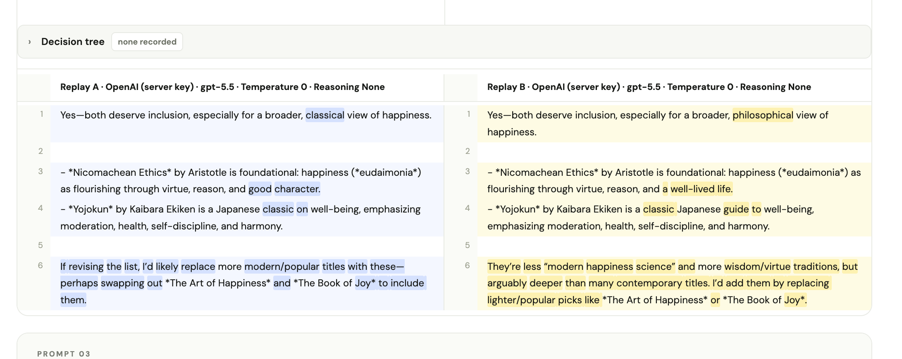
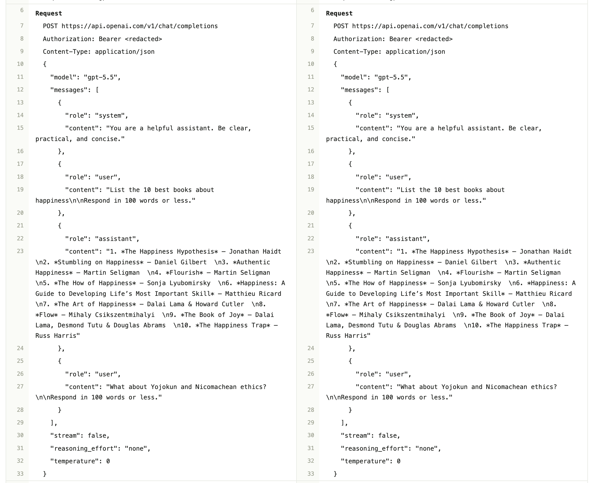

# Replay Chat

Same conversation. Different results.

Replay Chat is an educational tool for seeing how HARDWARE, KERNEL, and MODEL configurations change a conversation. You chat with an AI agent, then
**replay your prompts on two setups side by side** and compare the answers, the settings behind them, and the raw API
requests that produced them. A setup is a model on an API, and each API can be a different host. Point one at a model
running on one piece of hardware or kernel, and the other at another, to see what the hardware and kernel changed even when
the model is the same. Or keep the host and change the model and its settings. Nothing is hidden: the chat and the replay both show what was actually sent to the model.

## The problem

The same model behaves differently on different hardware. It also produces different results when the temperature is not
set to 0, and its output sometimes varies between kernel versions.

The point is that you must build your software systems to account for these variations in model output. Replay Chat lets
you see them for yourself, with your own prompts.

## What you can do

- **Chat** with an AI agent that can walk its own knowledge base (category, sub category, file) before it answers. Each
  conversation's agent, model, reasoning level, temperature, _KB summary tool_ and _Brief replies_ settings are chosen once
  and fixed, so conversations can be compared with each other.
- **Replay** a chat's prompts on Model A and Model B at once (each can come from a different API, so the same model can run on different hardware or kernels), one prompt at a time (_Step through_) or all of them
  (_Play all_). Replays are numbered per chat (Replay v1, v2, ...).
- **Diff** any two replays of a chat: a side-by-side line diff with word-level highlights, the _Model Diff_ (what differs in
  model and config), log probability _cliffs_ and the word where the two answers diverge, and the raw API requests of both
  replays side by side.
- **Read the API log**: every REST call made to the provider, for chats and replays, with the exact request, response and
  the settings each call actually carried. The API key is never stored in a log.
- **Manage APIs and knowledge bases**: add several API URLs on the Account page (OpenAI, Anthropic, Google Gemini,
  Fireworks AI, Featherless AI or a custom or local host) and edit each agent's knowledge base on the AI agents page.

Without a connected API the app runs in **demo mode** with canned replies, so every control can be tried first.

## See it

The same chat was replayed twice on the same model (`gpt-5.5`, reasoning None, temperature 0). The requests are identical, and the answers still differ.

**The Diff tab, Chat view:** both replays side by side, with the words that differ highlighted (blue in A, yellow in B).



**The Diff tab, API logs view:** the raw request behind each answer. Both sent the same prompt to `gpt-5.5` with `reasoning_effort` "none" and `temperature` 0, so nothing in the request explains the difference in the answers.



## Repository layout

| Folder                                            | What it is                                                                                                                            |
| ------------------------------------------------- | ------------------------------------------------------------------------------------------------------------------------------------- |
| [`replay-chat-vite/`](replay-chat-vite/README.md) | The frontend: Vite and vanilla JavaScript, one feature folder per page (Chat, Replay, AI agents, Account, Login), tested with Vitest. |
| [`backend/`](backend/README.md)                   | The FastAPI backend: SQLite, numbered migrations, `uv`, tested with pytest.                                                           |
| `run-site.sh`                                     | Starts the backend and the frontend together.                                                                                         |
| `_archive/`                                       | Older code kept for reference (ignored by git).                                                                                       |

Each folder's own README has the details; this page is the overview.

## Quick start

You need `uv` (Python), `npm` (Node), `curl` and `lsof`.

```sh
./run-site.sh            # backend on :8000, frontend on :5173
./run-site.sh restart    # replace whatever is holding those ports
./run-site.sh stop       # stop both, from any terminal
./run-site.sh reset      # fresh build: DELETE all four databases, rebuild them, run the seeders, then start (beta only)
./run-site.sh delete     # simulate a fresh install: stop, DELETE the four databases and exit (.env is not touched); the next ./run-site.sh is a first run
```

Open http://localhost:5173 and sign in as `demo` / `demo` (the seeded account; its password is `DEMO_PASSWORD`) or sign up.
The frontend proxies `/api` to the backend, so the browser sees one origin and the session cookie just works.

Then open **Account** and add an API (a URL, a label and a key, plus the models it serves). Without one, replies are demo
replies.

To run each half by hand, see the READMEs in `backend/` and `replay-chat-vite/`.

## Configuration

The backend reads `backend/.env`; `backend/run.sh` copies `backend/.env.example` on the first run and generates the
encryption key. The settings you are most likely to change:

| Setting                                              | Purpose                                                                                                      |
| ---------------------------------------------------- | ------------------------------------------------------------------------------------------------------------ |
| `OPENAI_API_KEY`, `OPENAI_BASE_URL`, `OPENAI_MODELS` | An optional server-wide OpenAI key. Every account sees it as one more API, "OpenAI (server key)", read only. |
| `MAX_USER_PROMPTS`                                   | The most prompts one chat may hold and one replay runs (default 10).                                         |
| `KB_ROUTING_ENABLED`                                 | Whether an agent walks its knowledge base before answering (up to three extra model calls).                  |
| `DEMO_PASSWORD`                                      | Password of the seeded `demo` account.                                                                       |
| `BLOCK_PRIVATE_LLM_URLS`                             | Refuse API URLs that resolve to private addresses. Turn it on for a shared deployment.                       |

`.env` holds secrets and must never be committed. See `backend/.env.example` for every setting.

## Data

Four SQLite files, kept in `backend/` and backed up together:

- `app.db`: accounts, conversations, messages, replay runs and saved replays.
- `knowledgebase.db`: each agent's categories, sub categories, files and the choices made while routing.
- `Log.db`: the raw API calls of chats and replays, and token log probabilities.
- `lessons.db`: the guided lessons (File > Lessons on the Chat page) and each user's progress through them. The lesson text lives in `backend/db/lesson_seeds/` and is refreshed on every start.

Migrations apply when the server starts, so restart it after pulling a change that adds one. The browser itself stores
nothing: no `localStorage`, `sessionStorage` or IndexedDB.

## Tests

```sh
cd backend && uv run pytest -q        # backend
cd replay-chat-vite && npm test       # frontend (an in-memory fake of the backend; fast)
cd replay-chat-vite && npm run test:live   # drives every page against a real backend (see its README)
```

## Pages

| Page      | URL             | What it is for                                                                          |
| --------- | --------------- | --------------------------------------------------------------------------------------- |
| Chat      | `/index.html`   | Talk to an agent. File menu: New, Open, Lessons, Config.                                   |
| Replay    | `/replay.html`  | Replay a chat on two models, then compare in History and Diff. File menu: Open, Lessons, Config. |
| AI agents | `/agents.html`  | Edit an agent's knowledge base. File menu: Open agent and the Add items.                |
| Account   | `/account.html` | Your APIs and their models.                                                             |
| Login     | `/login.html`   | Sign in or sign up.                                                                     |

## License

Replay Chat is released under the [Apache License, Version 2.0](LICENSE); see [NOTICE](NOTICE) for the copyright notice. You
can use it, change it and build a class or a product on it. If you share a changed version, keep the license and the notice,
and say which files you changed. The packages it depends on keep their own licenses.
